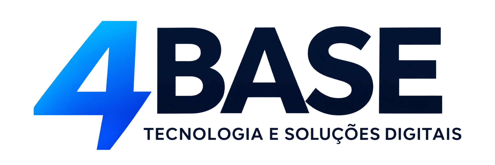
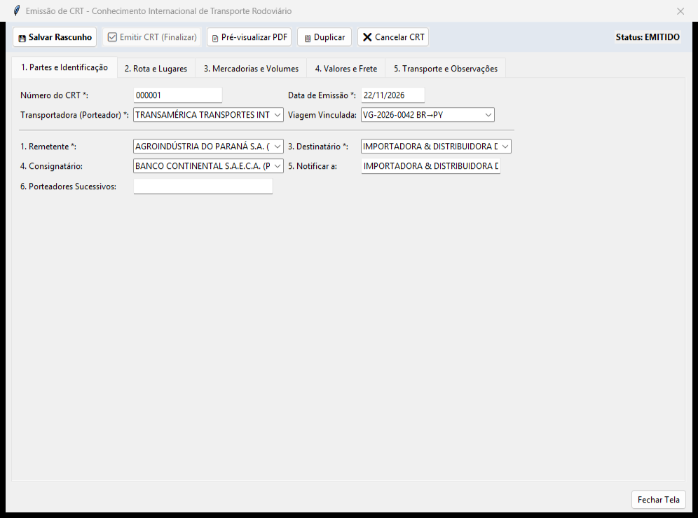
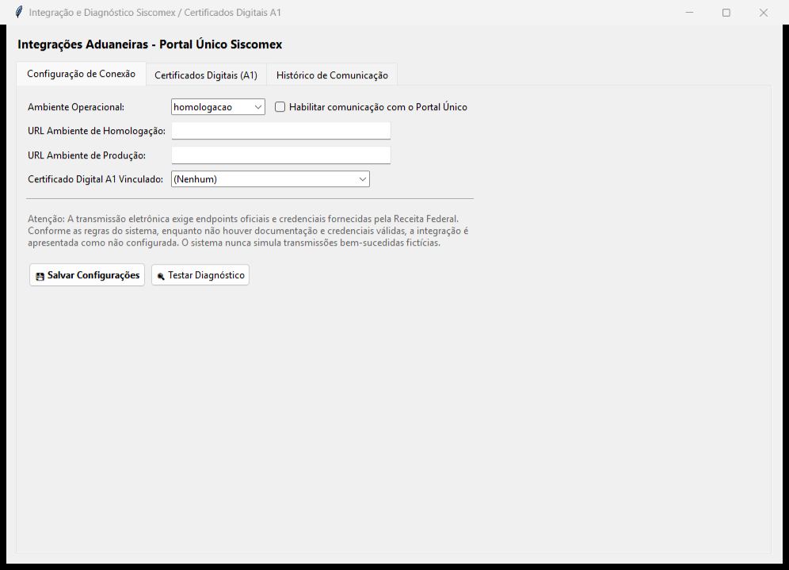

# 4BASE CRT/MIC-DTA Desktop (4BT)

  
   
  
<strong>Sistema Especialista em Documentos Aduaneiros e Transporte Internacional Rodoviário no Mercosul</strong>

  
  
  
  

---

## 📌 Sumário

1. [Visão Geral](#-visão-geral)
2. [Galeria de Telas do Sistema](#-galeria-de-telas-do-sistema)
3. [Funcionalidades e Módulos Operacionais](#-funcionalidades-e-módulos-operacionais)
   - [3.1 Cadastro da Empresa Transportadora](#31-cadastro-da-empresa-transportadora)
   - [3.2 Cadastros Operacionais (Participantes e Frota)](#32-cadastros-operacionais-participantes-e-frota)
   - [3.3 Gestão de Viagens Internacionais](#33-gestão-de-viagens-internacionais)
   - [3.4 Conhecimento Internacional de Transporte (CRT)](#34-conhecimento-internacional-de-transporte-crt)
   - [3.5 Manifesto Internacional de Carga com Trânsito Aduaneiro (MIC/DTA)](#35-manifesto-internacional-de-carga-com-trânsito-aduaneiro-micdta)
   - [3.6 Emissão, Visualizador e Impressão de Vias Oficiais](#36-emissão-visualizador-e-impressão-de-vias-oficiais)
   - [3.7 Siscomex, Certificados Digitais A1 e Diagnóstico](#37-siscomex-certificados-digitais-a1-e-diagnóstico)
   - [3.8 Backup e Restauração de Dados](#38-backup-e-restauração-de-dados)
4. [Como Baixar e Executar](#-como-baixar-e-executar)
5. [Licenciamento e Versão Desktop Free](#-licenciamento-e-versão-desktop-free)
6. [Sobre a 4BASE – desenvolvimento de Sistemas](#-sobre-a-4base--desenvolvimento-de-sistemas)
7. [Conformidade Legal e Legislação](#-conformidade-legal-e-legislação)

---

## 🌎 Visão Geral

O **4BASE CRT/MIC-DTA Desktop (4BT)** é um sistema desktop profissional e autônomo, desenvolvido especificamente para transportadoras rodoviárias de carga que realizam operações de transporte internacional entre os países signatários do **Acordo sobre Transporte Internacional Terrestre (ATIT)**:

- 🇧🇷 **Brasil**
- 🇵🇾 **Paraguai**
- 🇦🇷 **Argentina**
- 🇺🇾 **Uruguai**
- 🇧🇴 **Bolívia**
- 🇨🇱 **Chile**

Com interface clássica, limpa e produtiva no padrão nativo do Windows, o sistema foi projetado para garantir máxima agilidade operacional, sem telas desnecessárias ou dependência de servidores web externos. Todas as informações operacionais são salvas localmente com total privacidade e segurança no computador da transportadora.

---

## 🖥 Galeria de Telas do Sistema

### 1. Painel Principal & Operações
> Visão consolidada de viagens ativas, concluídas, rascunhos, relação de documentos emitidos e acompanhamento da cota mensal em tempo real.

---

### 2. Emissão de CRT (Conhecimento Internacional)
> Formulário oficial estruturado em 5 abas em estrita conformidade com os campos 1 a 24 do Conhecimento Internacional de Transporte Rodoviário do Mercosul.

---

### 3. Emissão de MIC/DTA (Trânsito Aduaneiro)
> Amarração dinâmica de múltiplos CRTs, totalização automática de volumes e pesos, controle de lacres alfandegários e seleção de aduanas homologadas.

---

### 4. Visualizador e Conferência de PDFs Oficiais do Mercosul
> Visualizador integrado de alta definição com suporte a zoom contínuo, navegação por páginas e impressão direta de todas as vias regulamentares.

---

### 5. Siscomex, Certificados Digitais A1 & Diagnóstico
> Configuração de conectividade com o Portal Siscomex, gerenciador de certificados digitais A1 corporativos e histórico auditável de diagnósticos.

---

## ⚡ Funcionalidades e Módulos Operacionais

### 3.1 Cadastro da Empresa Transportadora
- Razão Social, Nome Fantasia, CNPJ, Inscrição Estadual e Inscrição Municipal.
- Endereço completo com cidade, estado, país e código postal.
- Habilitações regulatórias: **RNTRC (ANTT)** e **Licença Internacional de Transporte Rodoviário**.
- Representante legal e CPF.
- Logotipo oficial da transportadora (aplicado automaticamente no cabeçalho das vias impressas do CRT e MIC/DTA).

### 3.2 Cadastros Operacionais (Participantes e Frota)
- **Participantes Comerciais:** Remetentes, Destinatários e Consignatários com preenchimento assistido e validação cadastral conforme o país de origem/destino (CNPJ/CPF no Brasil, RUC no Paraguai, CUIT na Argentina, RUT no Chile, etc.).
- **Motoristas / Condutores:** CPF, CNH com categoria e validade internacional, país emissor, documento de identidade, passaporte e status cadastral.
- **Veículos Tratores (Cavalos Mecânicos):** Placas (padrão Mercosul ou tradicional), Renavam, Chassi, Marca/Modelo, Ano, Tara, Capacidade em kg e Número de Eixos.
- **Reboques / Semirreboques:** Controle independente de implementos e carretas baú vinculáveis às viagens.
- **Tabelas de Aduanas de Fronteira:** Cadastro completo de aduanas de saída, fronteira e destino com códigos alfandegários oficiais.
- **Catálogo de Mercadorias:** Registro padronizado de cargas com código NCM/SH e tipo de embalagem.

### 3.3 Gestão de Viagens Internacionais
- Criação e monitoramento de viagens internacionais de Exportação, Importação e Trânsito Internacional.
- Vinculação com Cavalo Trator, Semirreboque, Condutor Habilitado e Transportadora.
- Definição de rota, pontos de aduana de saída e de entrada, local de carregamento e local de entrega final.
- Histórico consolidado de todos os documentos CRT e MIC/DTA emitidos para cada viagem.

### 3.4 Conhecimento Internacional de Transporte (CRT)
- Elaboração oficial em conformidade com as regras do Mercosul:
  - **1. Partes e Identificação:** Transportador, Remetente, Destinatário, Consignatário, Notificar a e Porteadores Sucessivos.
  - **2. Rota e Lugares:** Locais de recebimento, entrega e emissão com países de origem e destino.
  - **3. Mercadorias e Volumes:** Discriminação detalhada da carga, código NCM, embalagens, quantidade e pesos aferidos.
  - **4. Valores e Frete:** Moeda acordada (USD, BRL, ARS, PYG), frete valor, frete externo, seguro e condições de pagamento.
  - **5. Transporte e Observações:** Veículo, motorista, declarações alfandegárias e instruções para fiscalização.
- Numeração sequencial auditada e ciclo de vida: `RASCUNHO` ➔ `EMITIDO` ➔ `CANCELADO`.
- Bloqueio de segurança: documentos emitidos não podem ser alterados, preservando a validade jurídica.

### 3.5 Manifesto Internacional de Carga com Trânsito Aduaneiro (MIC/DTA)
- Seleção e amarração de um ou múltiplos CRTs emitidos da viagem.
- Totalização automática de pesos (bruto e líquido), quantidade de volumes e valor aduaneiro total.
- Controle de trânsito aduaneiro (DTA) com aduanas de partida e destino final.
- Registro de números de lacres alfandegários e identificação de contêineres.

### 3.6 Emissão, Visualizador e Impressão de Vias Oficiais
- Emissão no padrão A4 oficial para fiscalização de fronteira:
  - 1ª Via: Porteador / Transportador
  - 2ª Via: Aduana de Partida
  - 3ª Via: Aduana de Destino
  - 4ª Via: Destinatário / Consignatário
- Visualizador integrado com zoom, paginação e exportação direta em PDF de alta resolução.
- Prévia interna com marcação de rascunho para conferência prévia.

### 3.7 Siscomex, Certificados Digitais A1 e Diagnóstico
- Importação segura de Certificados Digitais A1 (`.pfx` / `.p12`).
- Proteção criptográfica avançada de credenciais no ambiente do Windows.
- Validação de titularidade, vigência e CNPJ do certificado.
- Diagnóstico em tempo real de conectividade com o Portal Único Siscomex.
- Auditoria com registro detalhado de comunicações e diagnósticos.

### 3.8 Backup e Restauração de Dados
- Geração de cópias de segurança locais e consistentes a qualquer momento.
- Verificação automática de integridade física dos dados antes do empacotamento.
- Restauração assistida para recuperação rápida de dados em novos computadores.

---

## 🚀 Como Baixar e Executar

O sistema é distribuído em formato **executável portátil para Windows**, sem necessidade de instalação:

1. Baixe o arquivo **`4bt-1.0.b.exe`**.
2. Salve o arquivo em qualquer pasta de sua preferência ou na Área de Trabalho.
3. Dê um duplo clique em **`4bt-1.0.b.exe`** para iniciar o sistema imediatamente.

> **Requisitos de Sistema:**
> - Sistema Operacional: Windows 10 ou Windows 11 (64 bits).
> - Não requer instalação de servidores ou softwares adicionais.
> - Não necessita de conexão com a internet para as operações locais diárias.

---

## 📋 Licenciamento e Versão Desktop Free

O **4BASE CRT/MIC-DTA Desktop** é disponibilizado gratuitamente na edição **Desktop Free** para que transportadoras informatizem e profissionalizem suas emissões:

- **Cadastros:** 100% Ilimitados (Empresas, Clientes, Motoristas, Veículos, etc.).
- **Gestão de Viagens:** 100% Ilimitada.
- **Emissão de CRTs:** 100% Ilimitada todos os meses.
- **Emissão de MIC/DTA:** Até **5 documentos por mês calendário**.
- **Consultas e Impressões:** Acesso permanente a todo o histórico de documentos emitidos.

> Para empresas com frotas de grande volume que necessitam de emissão ilimitada de MIC/DTA, múltiplos usuários simultâneos e armazenamento em nuvem, a 4BASE oferece a plataforma corporativa **4BASE Web Pro**.

---

## 🏢 Sobre a 4BASE – desenvolvimento de Sistemas

**Empresa de tecnologia e desenvolvimento de software focada em resultados.**

A **4BASE – Tecnologia e Soluções Digitais** é uma empresa de tecnologia e software house especializada em:
- [Desenvolvimento de Sistemas Personalizados](https://www.4base.com.br/desenvolvimento-de-sistemas-personalizados)
- [Sistema para Transportadoras (4BT)](https://www.4base.com.br/sistema-para-transportadoras)
- [Sistema ERP Empresarial](https://www.4base.com.br/sistema-erp-empresarial)
- [Criação de Sites Profissionais](https://www.4base.com.br/criacao-de-sites-profissionais)
- Infraestrutura e Consultoria de TI

Com mais de **10 anos de experiência em logística e tecnologia para empresas**, atendemos transportadoras e indústrias em **Foz do Iguaçu**, em todo o estado do **Paraná**, no **Brasil** e também no mercado internacional e fronteiriço (**Paraguai / Ciudad del Este**).

Unimos engenharia de software, conhecimento profundo de processos aduaneiros e suporte técnico consultivo para entregar plataformas web e aplicações empresariais que aumentam a produtividade e impulsionam o crescimento dos nossos clientes.

- 🌐 **Website Oficial:** [https://www.4base.com.br](https://www.4base.com.br)
- 🚚 **Módulo para Transportadoras:** [https://www.4base.com.br/sistema-para-transportadoras](https://www.4base.com.br/sistema-para-transportadoras)
- 📍 **Localização:** Foz do Iguaçu - PR - Brasil

---

## ⚖ Conformidade Legal e Legislação

O sistema atende rigorosamente às exigências normativas e acordos internacionais de transporte de carga:
- **Acordo sobre Transporte Internacional Terrestre (ATIT)** entre os governos de Brasil, Argentina, Bolívia, Chile, Paraguai, Peru e Uruguai.
- **Decreto Federal nº 99.704/1990** (promulgação do ATIT no Brasil).
- **Instruções Normativas da Receita Federal do Brasil (RFB)** relativas ao Trânsito Aduaneiro Internacional (DTA).
- **Resoluções da ANTT** pertinentes ao RNTRC e habilitação para transporte internacional de cargas.

---

  
© 2026 <strong>4BASE – Tecnologia e Soluções Digitais</strong>. Todos os direitos reservados.

