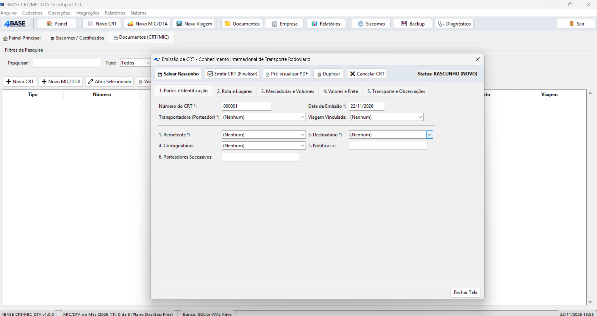
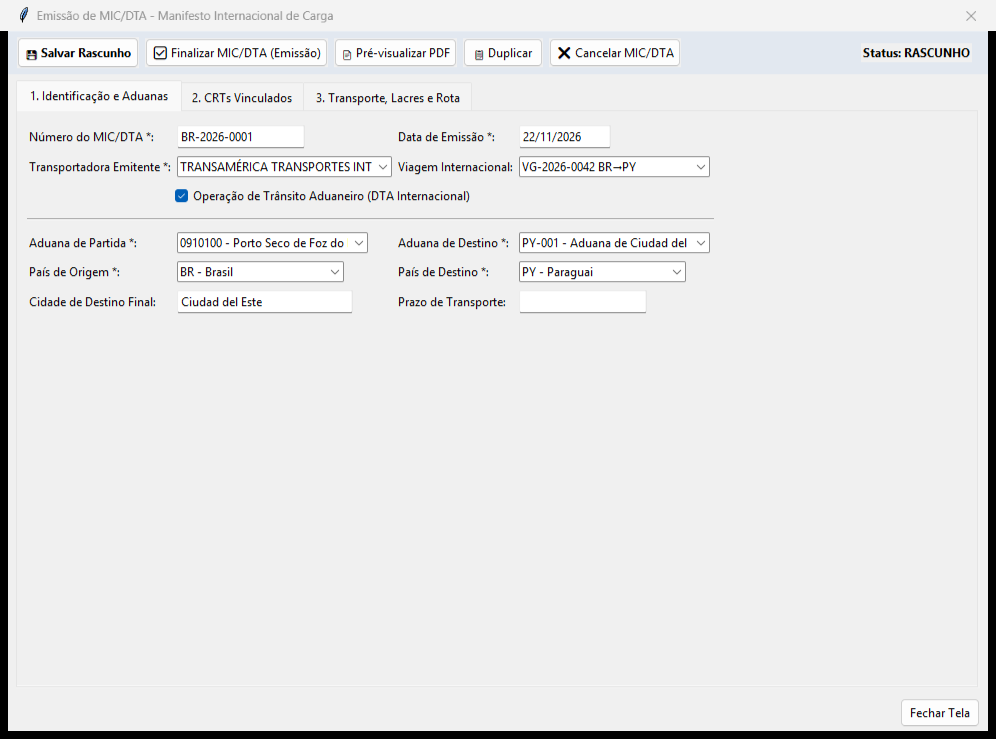
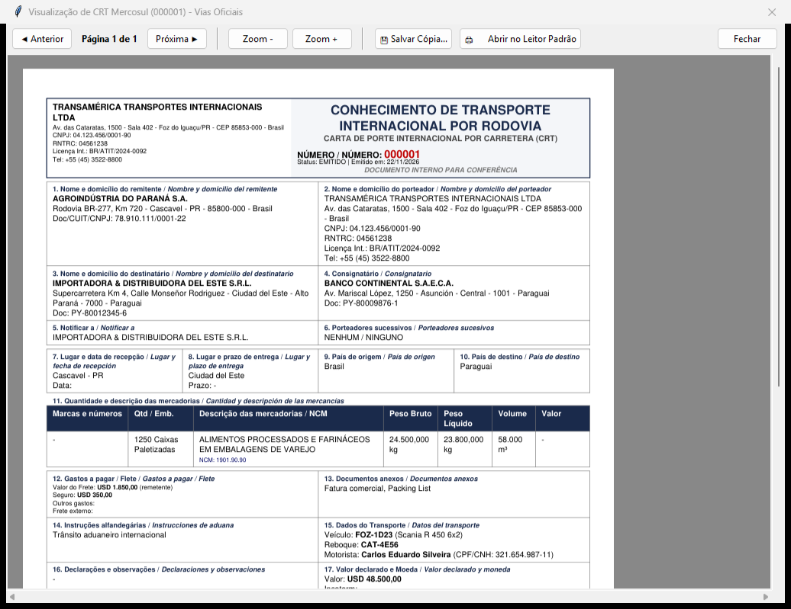

# 4BASE CRT/MIC-DTA Desktop

<div align="center">
  
  <br>
  <p><strong>Sistema Especialista em Documentos Aduaneiros e Transporte Internacional Rodoviário no Mercosul</strong></p>

  [](#)
  [](#)
  [](#)
  [-orange)](#)
  [](#)
</div>

---

## 📌 Sumário 

1. [Visão Geral](#-visão-geral)
2. [Galeria de Telas do Sistema](#-galeria-de-telas-do-sistema)
3. [Funcionalidades Principais](#-funcionalidades-principais)
   - [3.1 Cadastro da Empresa Transportadora](#31-cadastro-da-empresa-transportadora)
   - [3.2 Cadastros Operacionais (Participantes e Frota)](#32-cadastros-operacionais-participantes-e-frota)
   - [3.3 Gestão de Viagens Internacionais](#33-gestão-de-viagens-internacionais)
   - [3.4 Conhecimento Internacional de Transporte (CRT)](#34-conhecimento-internacional-de-transporte-crt)
   - [3.5 Manifesto Internacional de Carga com Trânsito Aduaneiro (MIC/DTA)](#35-manifesto-internacional-de-carga-com-trânsito-aduaneiro-micdta)
   - [3.6 Visualizador e Impressão de PDFs Oficiais](#36-visualizador-e-impressão-de-pdfs-oficiais)
   - [3.7 Siscomex, Certificados Digitais A1 e Diagnóstico](#37-siscomex-certificados-digitais-a1-e-diagnóstico)
   - [3.8 Backup e Restauração de Banco de Dados](#38-backup-e-restauração-de-banco-de-dados)
4. [Regra Comercial e Mecanismo Anti-Burla](#-regra-comercial-e-mecanismo-anti-burla)
5. [Arquitetura Técnica](#-arquitetura-técnica)
6. [Instalação e Execução](#-instalação-e-execução)
   - [6.1 Executável Standalone para Windows](#61-executável-standalone-para-windows)
   - [6.2 Execução a partir do Código-Fonte](#62-execução-a-partir-do-código-fonte)
   - [6.3 Executando os Testes Automatizados](#63-executando-os-testes-automatizados)
   - [6.4 Compilando com PyInstaller](#64-compilando-com-pyinstaller)
7. [Sobre a 4BASE – Desenvolvimento de Sistemas](#-sobre-a-4base--desenvolvimento-de-sistemas)
8. [Conformidade Legal e Legislação](#-conformidade-legal-e-legislação)

---

## 🌎 Visão Geral

O **4BASE CRT/MIC-DTA Desktop** é uma aplicação profissional desenvolvida especificamente para transportadoras rodoviárias de carga que realizam operações internacionais entre os países signatários do **Acordo sobre Transporte Internacional Terrestre (ATIT)**:

- 🇧🇷 **Brasil**
- 🇵🇾 **Paraguai**
- 🇦🇷 **Argentina**
- 🇺🇾 **Uruguai**
- 🇧🇴 **Bolívia**
- 🇨🇱 **Chile**

Projetado com a clássica e eficiente interface administrativa do Windows, o software opera de forma autônoma e descentralizada, gravando todas as informações em banco de dados local seguro no computador da transportadora, sem dependência de internet para cadastros e emissões locais.

---

## 🖥 Galeria de Telas do Sistema

### 1. Painel Principal & Operações
> Visão consolidada de viagens ativas, concluídas, rascunhos, histórico de documentos e indicador da cota mensal em tempo real.


---

### 2. Emissão de CRT (Conhecimento Internacional)
> Formulário oficial estruturado em 5 abas em estrita observância às caixas 1 a 24 do Conhecimento Internacional de Transporte Rodoviário Mercosul.


---

### 3. Emissão de MIC/DTA (Trânsito Aduaneiro)
> Amarração dinâmica de múltiplos CRTs, totalização automática de volumes e pesos, controle de lacres alfandegários e aduanas de fronteira.


---

### 4. Visualizador de PDF Oficial do Mercosul
> Motor de geração vetorial em alta definição com visualizador embutido, suporte a zoom contínuo, paginação e impressão direta das vias regulamentares.


---

### 5. Siscomex, Certificados Digitais A1 & Diagnóstico
> Painel de configuração de conectividade com o Portal Único Siscomex, gerenciador de certificados digitais A1 criptografados e auditoria de requisições.


---

## ⚡ Funcionalidades Principais

### 3.1 Cadastro da Empresa Transportadora
- Razão Social, Nome Fantasia, CNPJ, Inscrição Estadual e Inscrição Municipal.
- Endereço completo com formatação postal, cidade, estado e país.
- Dados de habilitação: **RNTRC (ANTT)** e **Licença Internacional de Transporte Rodoviário**.
- Representante legal e CPF.
- Logotipo oficial da transportadora com prévia em tela (inserido automaticamente no cabeçalho das vias do CRT e MIC/DTA).

### 3.2 Cadastros Operacionais (Participantes e Frota)
- **Participantes:** Remetentes, Destinatários e Consignatários com máscaras e validação matemática de CNPJ/CPF (Brasil) e identificações fiscais estrangeiras (RUC Paraguai, CUIT Argentina, RUT Chile, etc.).
- **Motoristas / Condutores:** CPF, CNH com categoria e validade, país emissor, número de passaporte e situação cadastral.
- **Veículos Tratores:** Placas (formato Mercosul ou tradicional), Renavam, Chassi, Marca/Modelo, Ano, Tara, Capacidade e Eixos.
- **Reboques / Semirreboques:** Controle independente de implementos vinculáveis às viagens.
- **Tabelas de Aduanas:** Aduanas de partida, fronteira e destino homologadas com códigos oficiais.
- **Mercadorias:** Catálogo padronizado com código NCM/SH e descrição aduaneira.
- **Exclusão Lógica (*Soft Delete*):** Preservação do histórico e integridade referencial de viagens anteriores.

### 3.3 Gestão de Viagens Internacionais
- Acompanhamento de viagens em andamento, planejadas e concluídas.
- Vinculação com Cavalo Trator, Semirreboque, Motorista Habilitado e Transportadora.
- Aduanas de saída e entrada, local de carregamento e local de entrega final.
- Relação de múltiplos documentos CRT e MIC/DTA emitidos por viagem.

### 3.4 Conhecimento Internacional de Transporte (CRT)
- Estruturação completa em conformidade com o modelo oficial:
  - **Aba 1 (Partes):** Transportador, Remetente, Destinatário, Consignatário, Notificar a e Porteadores Sucessivos.
  - **Aba 2 (Rota):** Locais e países de recebimento, entrega e emissão.
  - **Aba 3 (Carga):** Discriminação de mercadorias, NCM, embalagens, volumes e pesos bruto/líquido.
  - **Aba 4 (Valores & Frete):** Moeda (USD, BRL, ARS, PYG), frete valor, frete externo, seguro e condições de pagamento.
  - **Aba 5 (Transporte & Observações):** Veículo, condutor, declarações aduaneiras e instruções fiscais.
- Numeração sequencial auditada e ciclo de vida: `RASCUNHO` ➔ `EMITIDO` ➔ `CANCELADO`.
- Preservação jurídica: documentos finalizados são bloqueados contra edição indevida.

### 3.5 Manifesto Internacional de Carga com Trânsito Aduaneiro (MIC/DTA)
- Seleção e amarração de um ou múltiplos CRTs emitidos da viagem.
- Cálculo automático consolidado: total de volumes, peso bruto total, peso líquido total e valor aduaneiro total da carga.
- Registro de números de lacres alfandegários e identificação de contêineres.
- Especificação de trânsito aduaneiro (DTA) com aduanas de partida e destino.
- Verificação atômica e consumo da cota de emissão mensal antes da finalização.

### 3.6 Visualizador e Impressão de PDFs Oficiais
- Renderização vetorial precisa em folha A4 oficial das vias do CRT e MIC/DTA:
  - Via do Porteador / Transportador
  - Via para a Aduana de Partida
  - Via para a Aduana de Destino
  - Via do Destinatário / Consignatário
- Prévia interna com tarja d'água de rascunho antes da emissão definitiva.
- Componente de visualização em tela com zoom in/out, paginação e exportação.

### 3.7 Siscomex, Certificados Digitais A1 e Diagnóstico
- Importação segura de Certificados Digitais A1 (`.pfx` / `.p12`).
- Proteção criptográfica de credenciais via DPAPI (Windows) e algoritmos simétricos.
- Verificação de titularidade, validade, CNPJ e integridade da chave privada.
- Diagnóstico de conectividade em tempo real com o Portal Único Siscomex.
- Auditoria com histórico completo de requisições e diagnósticos.

### 3.8 Backup e Restauração de Banco de Dados
- Cópia de segurança consistente online através da SQLite Online Backup API.
- Teste físico prévio de integridade (`PRAGMA integrity_check`) na geração e restauração.
- Compactação segura em arquivo de backup com extensão `.4base`.

---

## 🛡 Regra Comercial e Mecanismo Anti-Burla

A edição **Desktop Free** do 4BASE foi concebida para atender pequenas operações e permitir que transportadoras informatizem suas rotinas gratuitamente:

- **Cadastros:** 100% Ilimitados.
- **CRTs:** Emissão 100% Ilimitada.
- **Viagens:** Gestão 100% Ilimitada.
- **MIC/DTA:** Limite de **5 emissões por mês calendário**.

### Proteção Anti-Adulteração Implementada
Para impedir burlas ou manipulação indevida da contagem de documentos:
1. **Auditoria Dupla:** O sistema cruza os registros da tabela `license_usage` com a contagem física real dos registros com `status = 'FINALIZADO'` na tabela `micdtas`. A validação adota sempre o maior valor.
2. **Gatilhos em Banco de Dados (SQLite Triggers):**
   - Gatilho `trg_prevent_delete_finalized_micdta`: Impede qualquer comando `DELETE` sobre documentos MIC/DTA finalizados.
   - Gatilho `trg_prevent_decrement_license_usage`: Impede atualizações que diminuam a quantidade de uso consumida.
3. **Detecção de Retrocesso de Relógio (Clock Rollback):** O sistema registra marcas temporais a cada operação. Se o relógio do Windows for atrasado para tentar reabrir cotas passadas, o validador bloqueia emissões e acusa inconsistência temporal.

---

## 🏗 Arquitetura Técnica

O projeto adota arquitetura modular em camadas, desacoplando regras de negócio, persistência, interface gráfica e emissão documental:

```text
c:\python_scripts\4b_mic\
│
├── main.py                          # Ponto de entrada da aplicação
├── 4base_crt_micdta_onefile.spec    # Especificação PyInstaller para Standalone EXE
├── requirements.txt                 # Dependências do projeto
├── alembic.ini                      # Configuração de migrações
├── index.html                       # Landing Page comercial e download do sistema
│
├── app/
│   ├── core/                        # Configuração, banco SQLite WAL, segurança e logging
│   ├── models/                      # Modelos declarativos SQLAlchemy 2.0 (CRT, MIC, Viagens, etc.)
│   ├── repositories/                # Consultas parametrizadas e filtros
│   ├── validators/                  # Validações matemáticas (CNPJ, CPF, Schemas)
│   ├── licensing/                   # Gestão centralizada da cota e regras anti-burla
│   ├── services/                    # Regras de negócio de CRT, MIC/DTA, Viagens e Cadastros
│   ├── documents/                   # Geradores de PDF (CRT e MIC/DTA) via ReportLab
│   ├── reports/                     # Relatórios operacionais e consolidação
│   ├── integrations/                # Siscomex Portal Único, certificados A1 e diagnóstico
│   └── ui/                          # Interface Tkinter/ttk (tema, janelas, menus, forms, views)
│
├── migrations/                      # Histórico de migrações versionadas do banco (Alembic)
├── tests/                           # Suíte de testes automatizados com pytest (13/13 aprovados)
├── assets/                          # Telas do sistema, ícones (.ico, .png) e logotipo oficial
└── dist/                            # Executável final compilado (4BASE_CRT_MICDTA.exe)
```

### Tecnologias Utilizadas
- **Linguagem:** Python 3.12 (64-bit)
- **Interface Gráfica:** Tkinter / ttk com tema clássico nativo do Windows
- **Banco de Dados:** SQLite em modo Write-Ahead Logging (WAL)
- **ORM & Migrações:** SQLAlchemy 2.0 e Alembic
- **Motor de PDF:** ReportLab (composição oficial) e PyMuPDF (renderização e visualização)
- **Criptografia:** Cryptography (gerenciamento seguro de certificados A1 e DPAPI)
- **Comunicação:** HTTPX (diagnóstico de conexões aduaneiras)
- **Distribuição:** PyInstaller (compilação para executável portátil nativo)

---

## 🚀 Instalação e Execução

### 6.1 Executável Standalone para Windows
A forma mais simples de utilizar o sistema é baixando o executável único homologado:
- **Arquivo:** `dist/4BASE_CRT_MICDTA.exe`
- Basta salvar o arquivo em qualquer pasta ou na Área de Trabalho e executar com duplo clique.
- **Requisitos de Sistema:** Windows 10 ou Windows 11 (64 bits).

### 6.2 Execução a partir do Código-Fonte
Para desenvolvedores que desejam executar ou contribuir com o projeto:

```bash
# 1. Clone o repositório
git clone https://github.com/4base/4base-crt-micdta.git
cd 4base-crt-micdta

# 2. Crie e ative um ambiente virtual
python -m venv venv
venv\Scripts\activate

# 3. Instale as dependências
pip install -r requirements.txt

# 4. Inicie o sistema
python main.py
```

### 6.3 Executando os Testes Automatizados
O projeto conta com uma suíte abrangente de testes cobrindo CRUDs, validações documentais, cálculo de frete, numeração sequencial e regras de cota com segurança anti-burla:

```bash
pytest -v
```

### 6.4 Compilando com PyInstaller
Para gerar o executável final portátil único (*onefile*):

```bash
pyinstaller --clean 4base_crt_micdta_onefile.spec
```
O arquivo gerado será gravado em `dist/4BASE_CRT_MICDTA.exe`.

---

## 🏢 Sobre a 4BASE – Desenvolvimento de Sistemas

**Empresa de tecnologia e desenvolvimento de software focada em resultados.**

A **4BASE – Tecnologia e Soluções Digitais** é uma empresa de tecnologia e software house especializada em:
- [Desenvolvimento de Sistemas Personalizados](https://www.4base.com.br/desenvolvimento-de-sistemas-personalizados)
- [Sistema para Transportadoras (4BT)](https://www.4base.com.br/sistema-para-transportadoras)
- [Sistema ERP Empresarial](https://www.4base.com.br/sistema-erp-empresarial)
- [Criação de Sites Profissionais](https://www.4base.com.br/criacao-de-sites-profissionais)
- Infraestrutura e Consultoria de TI

Com mais de **10 anos de experiência em logística e tecnologia para empresas**, atendemos transportadoras e indústrias em **Foz do Iguaçu**, em todo o estado do **Paraná**, no **Brasil** e também no mercado internacional e fronteiriço (**Paraguai / Ciudad del Este**).

Unimos engenharia de software, conhecimento profundo de processos aduaneiros e suporte técnico consultivo para entregar plataformas web e aplicações empresariais que aumentam a produtividade e impulsionam o crescimento dos nossos clientes.

- 🌐 **Website:** [https://www.4base.com.br](https://www.4base.com.br)
- 📍 **Sede:** Foz do Iguaçu - PR - Brasil

---

## ⚖ Conformidade Legal e Legislação

O sistema foi concebido respeitando estritamente os acordos e resoluções aplicáveis:
- **Acordo sobre Transporte Internacional Terrestre (ATIT)** entre os governos de Brasil, Argentina, Bolívia, Chile, Paraguai, Peru e Uruguai.
- **Decreto Federal nº 99.704/1990** (promulgação do ATIT no Brasil).
- **Instruções Normativas da Receita Federal do Brasil (RFB)** pertinentes ao Trânsito Aduaneiro Internacional (DTA).
- **Resoluções da ANTT** relativas ao RNTRC e licenças originárias de transporte internacional de cargas.

---

<div align="center">
  <p>© 2026 <strong>4BASE Tecnologia e Soluções Digitais</strong>. Todos os direitos reservados.</p>
</div>
